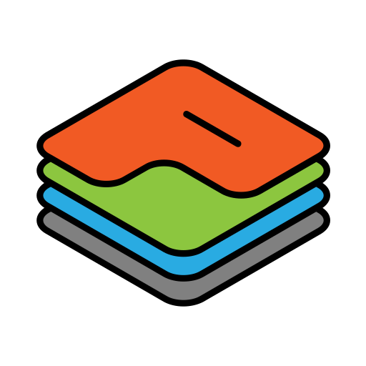

# Pingstack MCP server



[Pingstack](https://pingstack.io) monitors cron jobs and scheduled tasks with
heartbeat checks, and checks websites, TCP ports, DNS records, SSL
certificates and domain expiry. Its MCP server lets your coding agent set up
that monitoring and read the results for you.

Ask your agent to add a heartbeat check for the backup job it just wrote, with
the right cron schedule, time zone and grace period. Ask which checks had
incidents last week and how long they were down. Ask for your API's p95
latency over the last 30 days.

This repository holds the setup files and directory listings for the hosted
server. The server itself runs at Pingstack, so there's nothing to install or
run locally.

| | |
| --- | --- |
| Endpoint | `https://app.pingstack.io/mcp` |
| Transport | Streamable HTTP (stateless, JSON responses) |
| Sign-in | OAuth in your browser, or an API key |
| Price | Free for 15 checks. MCP is included on every plan |
| Docs | [docs.pingstack.io/mcp](https://docs.pingstack.io/mcp/overview/) |

## Connect

You need a Pingstack account. [Sign up free](https://app.pingstack.io/signup),
then add the server to your client. Leave out any Authorization header: the
client opens your browser, an Owner or Admin picks the Pingstack account, and
you approve the connection. Clients register themselves, so there's no client
ID or secret to copy.

**Claude Code**

```sh
claude mcp add --transport http pingstack https://app.pingstack.io/mcp
```

Then run `/mcp`, choose `pingstack` and sign in. Add `--scope user` to use it
in every project. You can also install it as a plugin:

```sh
/plugin marketplace add atomicvan/pingstack-mcp
/plugin install pingstack@pingstack
```

**Claude (claude.ai and Claude Desktop)**

Go to Settings → Connectors, choose **Add custom connector**, name it
Pingstack and enter `https://app.pingstack.io/mcp`.

**GitHub Copilot CLI**

```sh
copilot mcp add --transport http pingstack https://app.pingstack.io/mcp
```

If `/mcp` shows `needs-auth`, run `/mcp auth pingstack`.

**VS Code with Copilot**

Run **MCP: Add Server** from the Command Palette, choose **HTTP** and enter
the URL. Or add it to `.vscode/mcp.json`:

```json
{
  "servers": {
    "pingstack": {
      "type": "http",
      "url": "https://app.pingstack.io/mcp"
    }
  }
}
```

**Cursor**

Add this to `~/.cursor/mcp.json`, then sign in from Cursor's MCP settings:

```json
{
  "mcpServers": {
    "pingstack": {
      "url": "https://app.pingstack.io/mcp"
    }
  }
}
```

**OpenAI Codex**

```sh
codex mcp add pingstack --url https://app.pingstack.io/mcp
codex mcp login pingstack
```

**Google Antigravity**

Install the plugin in the `antigravity` folder with the Antigravity CLI. The
app picks it up too. You sign in in the browser the first time it connects:

```sh
git clone https://github.com/atomicvan/pingstack-mcp
agy plugin install ./pingstack-mcp/antigravity
```

Or add this to `~/.gemini/config/mcp_config.json`, then click **Authenticate**
next to `pingstack` under Agent settings → Customizations:

```json
{
  "mcpServers": {
    "pingstack": {
      "serverUrl": "https://app.pingstack.io/mcp"
    }
  }
}
```

**Gemini CLI**

Install it as an extension:

```sh
gemini extensions install https://github.com/atomicvan/pingstack-mcp
```

Then run `/mcp auth pingstack`.

The [client setup guide](https://docs.pingstack.io/mcp/clients/) covers
each client in more detail, plus how to use an
[API key](https://docs.pingstack.io/mcp/api-key/) when your client can't sign
in through a browser.

## Tools

The server has 20 tools. Your client only sees the ones the connection has
permission for.

| Tool | What it does |
| --- | --- |
| `get_account_capabilities` | Account, plan limits, usage, time zone and the fields each check type accepts |
| `list_checks` | List and filter checks |
| `get_check` | One check's settings, status, last run and expiry date |
| `create_check` | Create a heartbeat, website, TCP, DNS, SSL certificate or domain check |
| `update_check` | Change a check's settings |
| `get_check_ping_urls` | A heartbeat check's ping URLs (a separate permission, off by default) |
| `get_check_history` | Daily runs, latency and incidents for up to a year |
| `list_check_runs` | Individual runs for up to 90 days |
| `get_check_metrics` | Latency percentiles, by probe region or DNS resolver |
| `get_check_uptime` | Uptime over 7 days to a year |
| `list_incidents` | Incidents, filtered by check and state |
| `get_incident` | One incident |
| `list_notification_groups` | Alert groups you can send a check's alerts to |
| `list_dashboards` | Dashboards and status pages |
| `get_dashboard` | One dashboard and its checks |
| `create_dashboard` | Create a private dashboard |
| `update_dashboard` | Change a private dashboard |
| `attach_check_to_dashboard` | Add a check to a dashboard |
| `detach_check_from_dashboard` | Remove a check from a dashboard |
| `reorder_dashboard_checks` | Reorder a dashboard's checks |

History goes back as far as your plan keeps it. See the
[tool reference](https://docs.pingstack.io/mcp/tools/) for every argument.

## What it won't do

The server can't delete anything, publish a status page, manage custom
domains, pause checks, post incident updates or buy anything. Those stay in
the Pingstack app. Every connection is limited to one account, to the
permissions approved when it was connected, and to the approving person's
current role. At a plan limit it tells your agent the limit and returns an
upgrade link for a person to open.

Heartbeat ping URLs let anyone report a job as done, so the server only
returns them when you tick that permission while connecting.

## Example prompts

- Add a daily heartbeat for the backup job with a 15 minute grace period and put it on the Infrastructure dashboard.
- Which checks had incidents in the last 7 days, and how long were they down?
- Create website and SSL certificate checks for every domain in this README.
- What's the p95 latency for the API check over the last 30 days?
- How many checks do I have left on my plan?

## Support

- Docs: [docs.pingstack.io](https://docs.pingstack.io/mcp/overview/)
- Email: [support@pingstack.io](mailto:support@pingstack.io)
- Privacy policy: [pingstack.io/privacy-policy](https://pingstack.io/privacy-policy/)
- Terms: [pingstack.io/terms-conditions](https://pingstack.io/terms-conditions/)

Please report security issues to support@pingstack.io rather than opening a
public issue.

## License

The files in this repository are under the [MIT License](LICENSE). The
Pingstack service is covered by its [terms](https://pingstack.io/terms-conditions/).
